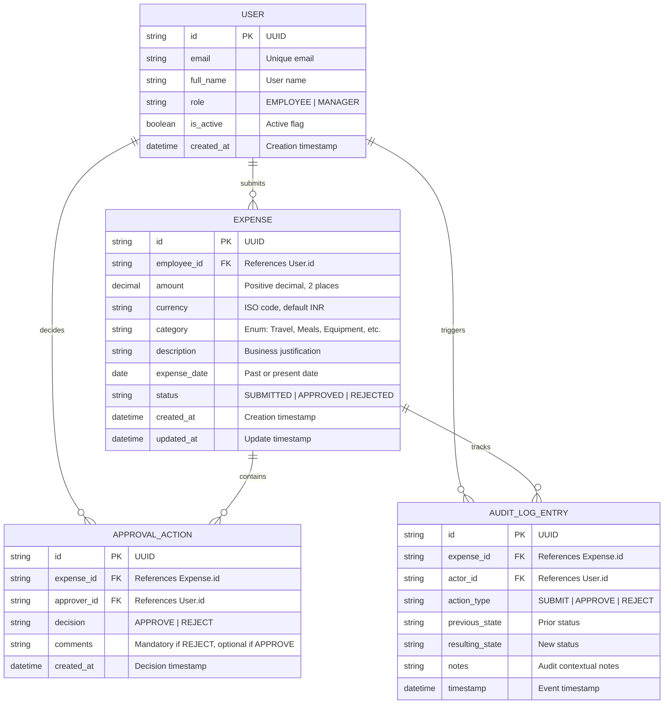
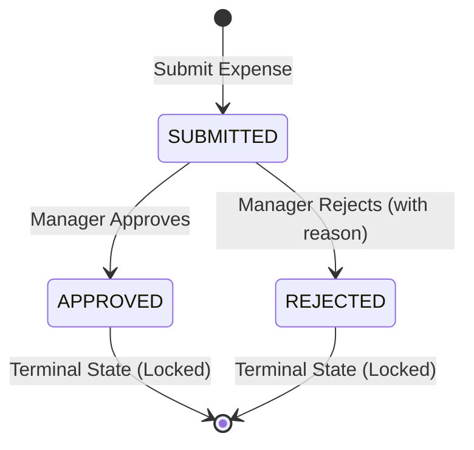

# Data Model: Expense Management System (MVP)

**Feature**: Expense Management System (MVP)
**Branch**: `001-expense-management`
**Date**: 2026-11-18
**Status**: Completed

## 1. Entity-Relationship Overview

---

## 2. Enumerations

### UserRole
| Value | Description |
| :--- | :--- |
| `EMPLOYEE` | Standard authenticated user permitted to submit and view own expenses. |
| `MANAGER` | Authorized reviewer permitted to view organization-wide pending queue and approve/reject expenses (except their own). |

### ExpenseCategory
Ratified in Clarification Session 2026-11-18:
| Value | Description |
| :--- | :--- |
| `Travel` | Airfare, train tickets, lodging, mileage, and transit costs. |
| `Meals` | Client entertainment, meals during official travel. |
| `Equipment` | Hardware accessories, monitors, ergonomic equipment. |
| `Software` | Cloud subscriptions, developer tools, licenses. |
| `Utilities` | Home internet, telecommunications stipends. |
| `Other` | Miscellaneous approved expenses requiring explicit notes. |

### ExpenseStatus (State Machine)
| Value | Type | Description |
| :--- | :--- | :--- |
| `SUBMITTED` | Active / Pending Review | Initial state upon submission. Awaiting manager review. Core details are immutable. |
| `APPROVED` | Terminal State | Final approved status. Immutable; cannot be modified or deleted. |
| `REJECTED` | Terminal State | Final rejected status with explanation. Immutable; cannot be reopened or edited. |

### DecisionAction
| Value | Description |
| :--- | :--- |
| `APPROVE` | Approver accepts the expense claim. |
| `REJECT` | Approver denies the expense claim (requires non-empty comments). |

---

## 3. State Machine & Transitions

### Transition Validation Rules
1. **Initial Submission (`[*] → SUBMITTED`)**:
   - Submitter MUST be an authenticated user.
   - All mandatory fields (`amount`, `category`, `expense_date`, `description`) MUST be populated and valid.
   - Initial status is recorded as `SUBMITTED`. Generates an `AuditLogEntry`.
2. **SUBMITTED → APPROVED**:
   - Approver MUST hold the `MANAGER` role.
   - Approver MUST NOT be the submitter (`approver_id != employee_id`).
   - Generates an `ApprovalAction` record and an `AuditLogEntry`.
3. **SUBMITTED → REJECTED**:
   - Approver MUST hold the `MANAGER` role.
   - Approver MUST NOT be the submitter (`approver_id != employee_id`).
   - Decision comments MUST be provided (non-empty string, min length 5).
   - Generates an `ApprovalAction` record and an `AuditLogEntry`.
4. **Disallowed Transitions & Operations**:
   - Update and delete operations are strictly prohibited in the MVP; expenses are immutable upon submission.
   - Any transition from `APPROVED` or `REJECTED` raises `StateTransitionError` (HTTP 409 Conflict).
   - Resubmission of a `REJECTED` expense is prohibited; employee must create a new expense entry.

---

## 4. Entity Specifications & Field Validations

### 4.1 Expense
| Field | Type | Nullable | Validation Rules |
| :--- | :--- | :--- | :--- |
| `id` | UUID (string) | No | Auto-generated UUIDv4 primary key. |
| `employee_id` | UUID (string) | No | Must reference an existing `User.id` with `EMPLOYEE` or `MANAGER` role. |
| `amount` | Decimal | No | MUST be > 0.00; maximum 2 decimal places (paise); max 1,000,000.00. |
| `currency` | String(3) | No | Default `INR` (₹); uppercase ISO 4217 currency code. |
| `category` | Enum | No | Must be one of `ExpenseCategory` members. |
| `description` | String(500) | No | Non-empty string; min length 3, max length 500 characters. |
| `expense_date`| Date | No | Must be less than or equal to `date.today()`. Future dates rejected. |
| `status` | Enum | No | Defaults to `SUBMITTED`. Transitions controlled by state machine. |
| `created_at` | DateTime | No | UTC timestamp of record creation. |
| `updated_at` | DateTime | No | UTC timestamp of last record update. |

### 4.2 ApprovalAction
| Field | Type | Nullable | Validation Rules |
| :--- | :--- | :--- | :--- |
| `id` | UUID (string) | No | Auto-generated UUIDv4 primary key. |
| `expense_id` | UUID (string) | No | References `Expense.id`. |
| `approver_id`| UUID (string) | No | References `User.id`. Must not equal `Expense.employee_id`. |
| `decision` | Enum | No | `APPROVE` or `REJECT`. |
| `comments` | String(1000)| Yes (if APPROVE), No (if REJECT) | If `decision == REJECT`, comments string must be trimmed and len >= 5. |
| `created_at` | DateTime | No | UTC timestamp of decision. |

### 4.3 AuditLogEntry
| Field | Type | Nullable | Validation Rules |
| :--- | :--- | :--- | :--- |
| `id` | UUID (string) | No | Auto-generated UUIDv4 primary key. |
| `expense_id` | UUID (string) | No | References `Expense.id`. |
| `actor_id` | UUID (string) | No | References `User.id` of actor initiating action. |
| `action_type`| String(50) | No | Action identifier (`SUBMIT`, `APPROVE`, `REJECT`). |
| `previous_state` | String(20) | Yes | Nullable for initial submission. |
| `resulting_state`| String(20) | No | Resulting `ExpenseStatus`. |
| `notes` | String(1000)| Yes | Optional contextual details or reasons. |
| `timestamp` | DateTime | No | UTC timestamp of the audit event. |
