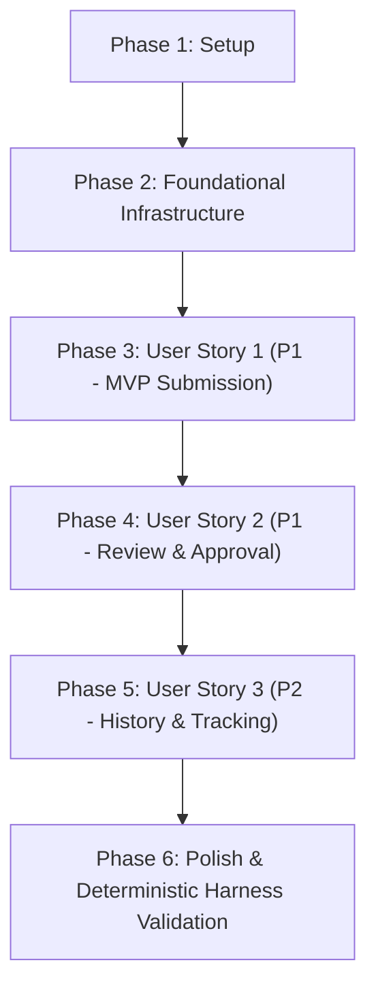

# Tasks: Expense Management System (MVP)

**Input**: Design documents from `specs/001-expense-management/`
- Specification: [spec.md](spec.md)
- Implementation Plan: [plan.md](plan.md)
- Technical Research: [research.md](research.md)
- Data Model: [data-model.md](data-model.md)
- API Contract: [contracts/expenses-api.yaml](contracts/expenses-api.yaml)
- Quickstart Guide: [quickstart.md](quickstart.md)

**Governance**: Project Constitution v2.0.0 (Strict TDD mandatory for deterministic systems; tests written and failing first).

**Organization**: Tasks are grouped by user story to enable independent implementation and testing of each story.

---

## Format: `- [ ] [TaskID] [P?] [Story?] Description with file path`

- **[P]**: Can run in parallel (different files, no dependencies on incomplete tasks)
- **[Story]**: User story identifier (`[US1]`, `[US2]`, `[US3]`) mapping directly to `spec.md`
- Exact file paths included in all task descriptions

---

## Phase 1: Setup (Shared Infrastructure)

**Purpose**: Project initialization, dependency management, and code quality tooling.

- [X] T001 Create project source and test directory structure per plan in src/ and tests/
- [X] T002 Initialize Python dependencies (FastAPI, Uvicorn, Pydantic, SQLAlchemy, Pytest, HTTPX, Ruff, Bandit, pip-audit) in requirements.txt
- [X] T003 [P] Configure code quality and security tooling (Ruff linter/formatter, Bandit SAST configuration) in pyproject.toml

---

## Phase 2: Foundational (Blocking Prerequisites)

**Purpose**: Core application infrastructure that MUST be completed before ANY user story can be implemented.

**⚠️ CRITICAL**: No user story implementation can begin until this foundational phase is complete.

- [X] T004 [P] Implement application configuration and environment settings via Pydantic Settings in src/config.py
- [X] T005 [P] Implement database engine and session maker with SQLite persistence in src/database.py
- [X] T006 [P] Implement shared enumeration types (`UserRole`, `ExpenseStatus`, `ExpenseCategory`, `DecisionAction`) in src/schemas/common.py
- [X] T007 [P] Implement `User` ORM entity and seed persona definitions in src/models/user.py
- [X] T008 [P] Implement simulated header authentication and role authorization dependency (`X-User-Id`, `X-User-Role`) in src/api/deps.py
- [X] T009 [P] Implement standardized API exception handlers and error response schemas in src/api/errors.py
- [X] T010 Create shared test fixtures (in-memory SQLite session, test client, seed personas) in tests/conftest.py

**Checkpoint**: Core foundation ready — User Story 1 implementation can now begin.

---

## Phase 3: User Story 1 - Submit Expense Request (Priority: P1) 🎯 MVP

**Goal**: Allow authenticated employees to submit expense claims in INR with amount, category, date, and description, recording them directly in `SUBMITTED` status with audit trail attribution.

**Independent Test**: An employee submits a valid expense payload; verify that HTTP 201 is returned, status is `SUBMITTED`, currency defaults to `INR`, and an audit log entry is created. Verify that invalid submissions (negative amount, future date, invalid category) return HTTP 400/422.

### Tests for User Story 1 (TDD - Tests Written & Failing First) ⚠️

> **NOTE: Write these tests FIRST, ensure they FAIL before implementation**

- [X] T011 [P] [US1] Write failing OpenAPI contract test for `POST /api/v1/expenses` in tests/contract/test_submit_contract.py
- [X] T012 [P] [US1] Write failing integration tests for expense submission happy path and validation rejections (negative amount, future date, invalid category) in tests/integration/test_expense_submit.py

### Implementation for User Story 1

- [X] T013 [P] [US1] Implement `AuditLogEntry` ORM entity in src/models/audit.py with fields citing data-model.md (`AuditLogEntry.action_type`, `AuditLogEntry.resulting_state`, `AuditLogEntry.actor_id`, `AuditLogEntry.expense_id`)
- [X] T014 [P] [US1] Implement `Expense` ORM entity in src/models/expense.py with fields citing data-model.md (`Expense.amount`, `Expense.currency`, `Expense.category`, `Expense.expense_date`, `Expense.description`, `Expense.status`, `Expense.employee_id`)
- [X] T015 [P] [US1] Implement Pydantic submission request and response schemas (`ExpenseCreateRequest`, `ExpenseResponse`) in src/schemas/expense.py citing validation constraints from data-model.md (`Expense.amount`, `Expense.currency`, `Expense.category`, `Expense.expense_date`, `Expense.description`)
- [X] T016 [US1] Implement audit logging service in src/services/audit_service.py to record immutable submission events
- [X] T017 [US1] Implement expense submission logic and state machine validation in src/services/expense_service.py
- [X] T018 [US1] Implement `POST /api/v1/expenses` endpoint in src/api/v1/expenses.py and mount router in src/main.py
- [X] T019 [US1] Execute and verify that all User Story 1 unit, contract, and integration tests pass (Red → Green)

**Checkpoint**: User Story 1 is fully functional and delivers a viable standalone MVP increment.

---

## Phase 4: User Story 2 - Review and Decide on Expense Requests (Priority: P1)

**Goal**: Allow managers to review pending expense submissions and either approve or reject them with mandatory comments, while preventing self-approval and enforcing terminal state locking.

**Independent Test**: A manager approves an expense (verifying status `APPROVED` and audit entry) and rejects another with feedback (verifying status `REJECTED`). Verify that self-approval attempts return HTTP 403 and attempts to modify an approved/rejected expense return HTTP 409.

### Tests for User Story 2 (TDD - Tests Written & Failing First) ⚠️

> **NOTE: Write these tests FIRST, ensure they FAIL before implementation**

- [X] T020 [P] [US2] Write failing OpenAPI contract tests for `POST /api/v1/expenses/{id}/approve` and `POST /api/v1/expenses/{id}/reject` in tests/contract/test_approval_contract.py
- [X] T021 [P] [US2] Write failing integration tests for manager approval, rejection with mandatory comment, self-approval block, and terminal state immutability in tests/integration/test_expense_approval.py

### Implementation for User Story 2

- [X] T022 [P] [US2] Implement `ApprovalAction` ORM entity in src/models/approval.py with fields citing data-model.md (`ApprovalAction.decision`, `ApprovalAction.comments`, `ApprovalAction.approver_id`, `ApprovalAction.expense_id`)
- [X] T023 [P] [US2] Implement Pydantic approval and rejection schemas (`ApprovalRequest`, `RejectionRequest`, `ApprovalActionResponse`) in src/schemas/approval.py citing constraints from data-model.md (`ApprovalAction.decision`, `ApprovalAction.comments`)
- [X] T024 [US2] Implement approval and rejection methods in src/services/expense_service.py enforcing `approver_id != employee_id`, mandatory rejection comments, and terminal state locking
- [X] T025 [US2] Implement `POST /api/v1/expenses/{id}/approve` and `POST /api/v1/expenses/{id}/reject` endpoints in src/api/v1/expenses.py
- [X] T026 [US2] Execute and verify that all User Story 2 unit, contract, and integration tests pass (Red → Green)

**Checkpoint**: User Stories 1 AND 2 are both fully functional and tested.

---

## Phase 5: User Story 3 - View Expense History and Status (Priority: P2)

**Goal**: Allow employees to view their own expense history and managers to view the organization-wide review queue, with filtering by status, category, and date range.

**Independent Test**: Log in as an employee to query personal expenses with status filters; log in as a manager to query all pending submissions; retrieve single expense detail and verify full audit trail.

### Tests for User Story 3 (TDD - Tests Written & Failing First) ⚠️

> **NOTE: Write these tests FIRST, ensure they FAIL before implementation**

- [X] T027 [P] [US3] Write failing OpenAPI contract tests for `GET /api/v1/expenses` and `GET /api/v1/expenses/{id}` in tests/contract/test_history_contract.py
- [X] T028 [P] [US3] Write failing integration tests for user history filtering, manager review queue querying, and detailed audit history in tests/integration/test_expense_history.py

### Implementation for User Story 3

- [X] T029 [P] [US3] Implement `ExpenseDetailResponse` schema with nested approval actions and audit entries in src/schemas/expense.py
- [X] T030 [US3] Implement query filtering and detail retrieval methods in src/services/expense_service.py
- [X] T031 [US3] Implement `GET /api/v1/expenses` and `GET /api/v1/expenses/{id}` endpoints in src/api/v1/expenses.py
- [X] T032 [US3] Execute and verify that all User Story 3 unit, contract, and integration tests pass (Red → Green)

**Checkpoint**: All three user stories are fully implemented, verified, and integrated.

---

## Phase 6: Polish & Cross-Cutting Concerns

**Purpose**: CI automation, end-to-end quickstart validation, deterministic harness verification, and evidence logging.

- [X] T033 [P] Configure proportionate GitHub Actions CI workflow (Ruff linting, Pytest, Bandit, pip-audit) in .github/workflows/ci.yml
- [X] T034 Execute full end-to-end quickstart validation scenarios from specs/001-expense-management/quickstart.md
- [X] T035 Verify test coverage across all domain components and run Ruff linter check across repository
- [X] T036 [P] Execute Bandit SAST security scan against application source code in src/ and preserve raw scanner output for specs/001-expense-management/harness-log.md
- [X] T037 [P] Execute pip-audit dependency vulnerability scan against requirements.txt and preserve raw audit output for specs/001-expense-management/harness-log.md
- [X] T038 Capture baseline failures across validation gates (Pytest, Ruff, Bandit, pip-audit) as structured evidence in specs/001-expense-management/harness-log.md
- [X] T039 Record exact commands, tool versions, configurations, and validation gates used in the initial harness run, repair detected issues across codebase and dependencies, rerun the exact same validation gates using identical configurations, and preserve raw rerun outputs in specs/001-expense-management/harness-log.md
- [X] T040 Verify and record final validation evidence in specs/001-expense-management/harness-log.md, documenting passing unit, integration, and contract tests, successful Ruff checks, Bandit findings with severity and disposition, pip-audit findings with affected dependencies and disposition, absence of unresolved blocking security findings, and student observations based on actual scanner output

---

## Dependencies & Execution Order

### Phase Dependencies



- **Setup (Phase 1)**: Independent, starts immediately.
- **Foundational (Phase 2)**: Depends on Setup; BLOCKS all User Stories.
- **User Story 1 (Phase 3)**: Depends on Foundational completion. Delivers working MVP.
- **User Story 2 (Phase 4)**: Depends on User Story 1 (approves/rejects submitted expenses).
- **User Story 3 (Phase 5)**: Depends on User Story 1 & 2 (displays submissions and approval decisions).
- **Polish (Phase 6)**: Runs after all User Stories pass verification.

---

## Parallel Execution Opportunities

### Phase 2 (Foundational)
```bash
# Launch independent foundational components in parallel:
Task T004: src/config.py
Task T005: src/database.py
Task T006: src/schemas/common.py
Task T007: src/models/user.py
Task T008: src/api/deps.py
Task T009: src/api/errors.py
```

### Phase 3 (User Story 1)
```bash
# Launch US1 tests in parallel (written first):
Task T011: tests/contract/test_submit_contract.py
Task T012: tests/integration/test_expense_submit.py

# Launch US1 models and schemas in parallel:
Task T013: src/models/audit.py
Task T014: src/models/expense.py
Task T015: src/schemas/expense.py
```

### Phase 4 (User Story 2)
```bash
# Launch US2 tests in parallel:
Task T020: tests/contract/test_approval_contract.py
Task T021: tests/integration/test_expense_approval.py

# Launch US2 models and schemas in parallel:
Task T022: src/models/approval.py
Task T023: src/schemas/approval.py
```

### Phase 5 (User Story 3)
```bash
# Launch US3 tests in parallel:
Task T027: tests/contract/test_history_contract.py
Task T028: tests/integration/test_expense_history.py
```

### Phase 6 (Polish & Deterministic Harness)
```bash
# Launch security and vulnerability scans in parallel:
Task T036: Bandit SAST scan against src/
Task T037: pip-audit scan against requirements.txt
```

---

## Implementation Strategy

### MVP First (Phases 1, 2, and 3)
1. Complete Phase 1 (Setup) and Phase 2 (Foundational).
2. Complete Phase 3 (User Story 1 - Submission).
3. **STOP and VALIDATE**: Run `tests/integration/test_expense_submit.py` to confirm that employees can submit expenses in INR with audit logging.
4. Deliver/demo viable MVP increment.

### Incremental Feature Expansion
1. Implement Phase 4 (User Story 2) → Managers can review, approve, and reject submissions.
2. Implement Phase 5 (User Story 3) → Full history, queue querying, and status filtering enabled.
3. Implement Phase 6 (Polish) → CI pipeline configured, quickstart verified, 100% test pass.
